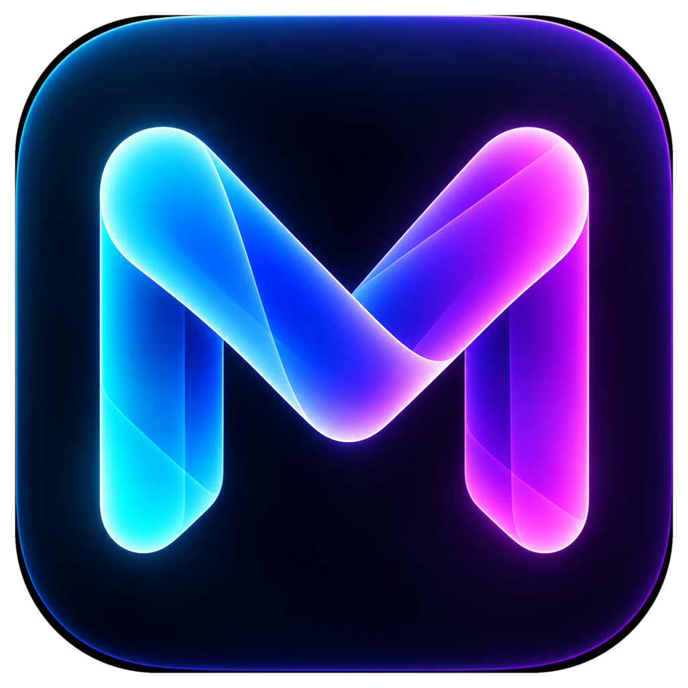

<p align="center">
  
</p>

<h1 align="center">MorpheX Live</h1>

<p align="center">
  A fast, lightweight live wallpaper engine for Windows 10 and 11.
</p>

<p align="center">
  
  
  
  
  
</p>

---

## Why MorpheX?

Most live wallpaper apps out there chew up 500MB to 1GB of memory and keep your GPU running hot even when you have a game running.

I built **MorpheX** to have something clean, minimal, and resource-friendly:
- When you are on your desktop, you get buttery-smooth 60fps video playback with hardware acceleration.
- The instant you launch a fullscreen game or open a work app, playback pauses immediately and drops to **0.0% CPU and 0.0% GPU**.
- It sits quietly in your system tray without spamming notifications or running background telemetry.

---

## Features

- **Built-in Master CC0 Wallpapers**: Ships with a curated collection of stunning high-resolution CC0 wallpapers out-of-the-box so your desktop looks incredible immediately upon installation.
- **Dedicated Desktop Profiles Hub**: Dedicated page to create, rename, save, and switch between customized desktop profiles (e.g., *Productivity*, *Cyberpunk Setup*, *Late Night Chill*) in a single click from the UI or right from the system tray. Safely restores widget configurations, styling, and wallpaper pairings with graceful fallback if a wallpaper was removed.
- **Dedicated Effects & Appearance Page**: Complete control over visual filters (Brightness, Contrast, Saturation, Color Temperature, Reset), Video Playback speeds, and Ambient Dimming in a clean, uncluttered interface.
- **Polished Fluent Vector UI**: Native Segoe Fluent icons, vector layout diagrams, and styled typography badges across all widget pickers, dropdowns, and settings.
- **Direct3D 11 Hardware Acceleration**: Powered by LibVLC with native GPU decoding (`.mp4`, `.webm`, `.mov`, `.mkv`, `.avi`).
- **Smart Pause Detection**: Automatically freezes video playback when running fullscreen games or applications so your frame rates never take a hit.
- **Multi-Monitor Support**: Assign different wallpapers to each display, adjust volume independently per monitor, or mute individual screens.
- **Wallpaper Playlist & Auto-Rotation**: Shuffle or cycle through your library on a customizable timer. Filter by favorites. Postpones rotation while in a game.
- **Desktop Widgets**: Transparent, drag-and-drop overlays with custom scaling, frosted card options, and dark/light themes.
- **Real-Time Weather Widget**: Live temperature, condition, high/low, humidity, and wind speed powered by free Open-Meteo API (no API key required). Features dynamic Google Weather-style background gradients, automatic IP geolocation or city search, and crisp vector weather icons.
- **Audio Visualizer**: Live audio reactive spectrum analyzer (WASAPI loopback) with vector styles (Equalizer Bars, Mirrored Center, and Smooth Waveform Curve) and vibrant gradient theme presets.
- **Minimalist Clock & Day Widget**: Sleek typography with designer fonts (Anurati, Bahnschrift, Segoe UI, Consolas) and glowing drop shadows.
- **System Monitor Widget (SysMon)**: Real-time hardware rings displaying CPU, GPU, RAM, and Disk metrics with horizontal row, vertical column, and 2x2 grid vector presets.
- **Custom Global Hotkeys**: Set keyboard shortcuts to pause/resume, mute/unmute, or skip wallpapers from anywhere in Windows.
- **Native Windows Shell Integration**: Embeds cleanly behind your desktop icons using the `WorkerW` layer without interfering with desktop clicks.
- **Secure 1-Click Built-in Updates**: Check for and install updates directly inside the app with URL origin validation, SHA-256 integrity verification, and safe executable staging.
- **Fast Startup**: Optimized desktop integration initialization — typically under 1 second on most systems.

---

## Installation

### Installer (Recommended)
Grab the latest setup from the [**Releases**](https://github.com/MorpheusDark7/MorpheX/releases) page:
1. Download `MorpheX-Live-Setup-v*.exe`.
2. Run the installer and click Next.
3. Launch MorpheX from your Start Menu or Desktop.

*(Future updates can be installed with a single click right inside the app settings.)*

---

## Supported Formats

| Format | Extensions | Engine |
|---|---|---|
| **Video** | `.mp4`, `.webm`, `.mkv`, `.mov`, `.avi` | LibVLC with Direct3D 11 GPU decode |
| **Static Images** | `.png`, `.jpg`, `.jpeg`, `.webp`, `.bmp` | Fast WIC image loader |

---

## Building from Source

### Requirements
- Windows 10 (1809+) or Windows 11 (64-bit)
- [.NET 8.0 SDK](https://dotnet.microsoft.com/download/dotnet/8.0)
- Visual Studio 2022, JetBrains Rider, or VS Code

### Steps
```powershell
# 1. Clone the repository
git clone https://github.com/MorpheusDark7/MorpheX.git
cd MorpheX

# 2. Restore NuGet dependencies
dotnet restore

# 3. Build in Release mode
dotnet build -c Release

# 4. (Optional) Publish a self-contained single executable
dotnet publish src/MorpheX/MorpheX.csproj -c Release -r win-x64 --self-contained -p:PublishSingleFile=true -o ./publish
```

To compile the setup installer, open `installer.iss` in [Inno Setup 6](https://jrsoftware.org/isinfo.php) and click **Compile**.

---

## Architecture Overview

```
MorpheX/
├── src/
│   ├── MorpheX/             # WPF Front-end UI (MVVM, Fluent Design, Views, Widgets)
│   └── MorpheX.Core/        # Core Engine
│       ├── Configuration/   # App settings & library manifests
│       ├── Desktop/         # Win32 WorkerW shell integration & host windows
│       ├── Detection/       # Fullscreen, battery, and Explorer restart watchers
│       ├── Models/          # Monitor, wallpaper, and performance data models
│       ├── Providers/       # Video (LibVLC) and image wallpaper providers
│       ├── Services/        # Playback, playlist, audio, metrics, and update services
│       └── Utilities/       # Win32 memory trimming & shell thumbnail helpers
├── installer.iss            # Inno Setup packaging script
└── .github/workflows/       # GitHub Actions CI/CD pipeline
```

---

## Changelog

### v0.1.63
- **Multi-Monitor Smart Pause Fix** — Fixed wallpaper pause detection across multiple monitors with DWM cloaked window filtering and extended tolerance margins, ensuring maximized and fullscreen applications on any display correctly trigger playback pausing.
- **Configurable Multi-Monitor Pause Mode** — Choose between pausing only on the monitor running the maximized app or pausing all monitors simultaneously whenever an active app is fullscreen or maximized.
- **Enhanced Battery Power Detection** — Added Win32 `SystemPowerStatus` fallback for battery status detection, ensuring laptops pause properly on DC battery power without false triggers on AC desktop systems.
- **Streamlined Release Deployments** — Optimized deploy artifacts and updated Microsoft Store installer distribution.

### v0.1.62
- **Span Screen Placement Mode** — Seamlessly stretch single wallpapers across multi-monitor virtual screens with automatic topology detection and resize adaptation.
- **Clock Widget Transparency Fix** — Ensured persistent `WS_EX_LAYERED` composition and DWM frame synchronization to eliminate visual artifacts, unwanted backgrounds, and focus-stealing.
- **Smooth Playback & Memory Optimization** — Replaced aggressive blocking working-set flushes with non-blocking Gen 1 GC optimization, eliminating video hitching/glitches when switching windows.
- **Dynamic Live Video Scaling** — Instant scaling mode updates (Crop to Center, Fit to Screen, Stretch) applied live without reloading active media.
- **Process Windows Ghosting Prevention** — Integrated `DisableProcessWindowsGhosting` to keep desktop render loops responsive during intensive graphics transitions.

### v0.1.61
- **Installer Size Optimization** — Pruned unused multimedia and subtitle plugins from bundled LibVLC and disabled ReadyToRun binary inflation, reducing download size to ~75MB for direct deployment.

### v0.1.59
- **Real-Time Weather Widget** — Live temperature, weather conditions, automatic geolocation, and dynamic gradient cards.
- **Audio Visualizer & Clock Typography** — Upgraded vector visualizer styles (Equalizer Bars, Mirrored Center, Smooth Waveform) and modern clock typography.
- **Refreshed High-Resolution Branding** — High-definition app icons and visual identity across desktop dialogs and store assets.
- **Responsive Compact Navigation** — Dynamic navigation sidebar that automatically collapses for compact windows with titlebar hamburger toggle.
- Bug fixed.

### v0.1.58
- **Edge-to-Edge Clean Interface** — Removed the bottom status bar for a clean, modern, borderless window aesthetic.
- **Unified Sidebar Navigation** — Consolidated Settings into primary navigation list.
- **Performance & Caching** — Decoded bitmap caching in thumbnail loader eliminating redundant disk decodes.
- Bug fixed.

### v0.1.57
- **Dedicated Global Keybinds Page** — Centralized shortcut management for playback, navigation, and power user controls.
- **Video Scaling Modes** — Added Crop to Center, Fit to Screen, and Stretch modes with real-time live preview.
- **Theme & Contrast Hardening** — Dynamic theme brushes ensuring crisp readability across dark and light modes.
- Bug fixed.

### v0.1.56
- **Full Light & Dark Theme Support** — Added comprehensive Light, Dark, and System Default theme switching.
- **Cinematic 16:9 Cards** — Modern wallpaper cards with smoked-glass gradient overlays and clean typography.
- **Multi-Monitor Placement Modes** — Per-Display, Duplicate / Mirror, and Span Screen placement options.
- Bug fixed.

### v0.1.55
- **Dynamic System Accent Theme Adaptation** — Real-time Windows 11 system accent synchronization with automated WCAG contrast protection.
- **Subtle Opacity Accent Styling** — Translucent accent washes and borders tailored for dark desktop aesthetics.
- Bug fixed.

### v0.1.54
- **Automatic Video Resolution Detection** — Hardware video track probing to detect and display video resolution badges (4K, 1440p, 1080p).
- **Rich Smoked Glass & Contrast Boost** — Smoked glass widget styling with boosted typography contrast.
- **Aesthetic Color Palettes** — Curated aesthetic color presets for desktop widgets.
- Bug fixed.

### v0.1.53
- **Independent Desktop Profiles** — Multi-monitor configurations and widget layouts saved and restored per profile.
- **Immediate Drag-and-Drop Auto-Save** — Moving widgets across desktops automatically persists positions in real-time.
- **Responsive Library Header** — Adaptive two-tier layout ensuring controls remain visible at any window width.
- Bug fixed.

### v0.1.52
- **Dedicated Desktop Profiles Hub** — Standalone dashboard for creating, customizing, and switching desktop setups.
- **Dedicated Effects & Appearance Page** — Dedicated page for visual filters (Brightness, Contrast, Saturation), playback speeds, and ambient dimming.
- **Vector UI & Fluent Visuals** — Modern vector layout diagrams, typography preview badges, and Segoe Fluent icons.
- Bug fixed.

### v0.1.51
- **Bundled CC0 Master Wallpapers** — Curated high-resolution wallpapers included out-of-the-box.
- **Desktop Profiles System** — Core profiles engine saving and restoring per-monitor wallpapers and widget configurations.
- **Updater Hardening & SHA-256 Verification** — Automated SHA-256 checksum verification before executing update installers.

### v0.1.50
- **Automated Update Pipeline** — In-app update checks with staging path containment verification.
- Bug fixed.

### v0.1.38
- **Simplified Format Support** — High-performance, GPU-accelerated video formats (`.mp4`, `.webm`, `.mov`, `.mkv`, `.avi`) and static wallpapers.
- **Bulk Library Management** — One-click library management and Fluent dark dialogs.
- Bug fixed.

### v0.1.28
- **Toggleable Neon Glow** — Audio visualizer neon glow effects.
- **Frosted Glass Acrylic Option** — Smoked acrylic styling for desktop widgets.
- Bug fixed.

### v0.1.27
- **Multi-GPU Engine Tracking** — Dedicated GPU metrics tracking for discrete GPUs.
- **Custom Font Support** — Modern typography options for desktop clock and day widgets.

---

## License

Released under the [MIT License](LICENSE). Free for personal and commercial use.
